<p align="center">
  
</p>

<h1 align="center">Schedule Everything</h1>

<p align="center">
  <strong>Your AI agent plans the week. Persistent reminders keep you on it.</strong><br>
  A local-first weekly routine, task list, and focus-block reminder app with a vivid browser workspace and the <code>rmd</code> CLI.
</p>

<p align="center">
  <a href="https://github.com/AutoPhd-org/schedule-everything/actions/workflows/logic-tests.yml"></a>
  <a href="https://github.com/AutoPhd-org/schedule-everything/actions/workflows/cli-tests.yml"></a>
  <a href="https://github.com/AutoPhd-org/schedule-everything/actions/workflows/browser-tests.yml"></a>
  <a href="https://pypi.org/project/schedule-management"></a>
  <a href="https://opensource.org/licenses/MIT"></a>
</p>

<p align="center">
  <a href="#quick-start">Quick start</a> ·
  <a href="#a-tour-of-the-workspace">Tour</a> ·
  <a href="#commands">Commands</a> ·
  <a href="https://autophd-org.github.io/schedule-everything/">Documentation</a> ·
  <a href="README_zh.md">中文</a>
</p>

<p align="center">
  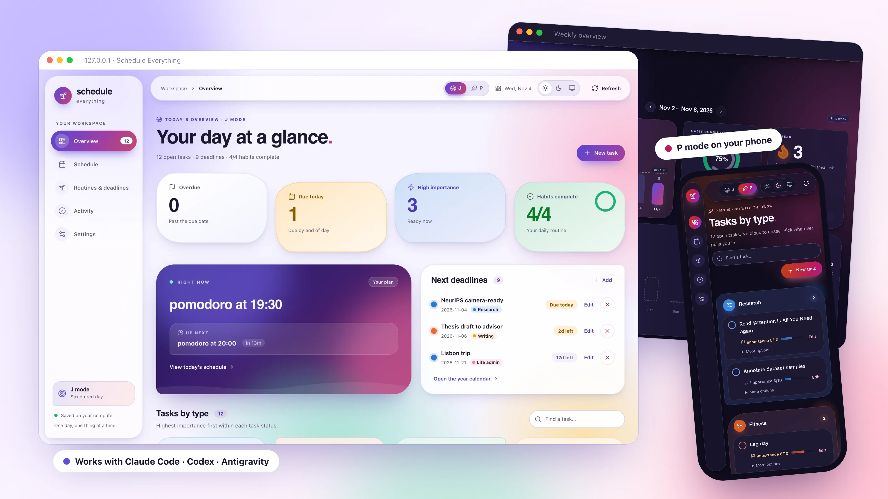
</p>

## Why Schedule Everything

<table>
  <tr>
    <td width="33%" valign="top">
      <h3>🧠 Your agent plans</h3>
      Tell Claude Code, Codex, or Antigravity about your life. Its <code>build-schedule</code> skill interviews you and writes your weekly routine; <code>plan-day</code> fills today's focus blocks with real tasks.
    </td>
    <td width="33%" valign="top">
      <h3>⏰ Reminders that stick</h3>
      A background service sounds an alarm and shows a dialog at the start and end of every block until you respond. Deadlines, habits, and urgent tasks get their own nudges.
    </td>
    <td width="33%" valign="top">
      <h3>🔒 Local and plain text</h3>
      Your routine is TOML, your tasks and history are JSON, all on your computer. The app makes no AI calls itself; your agent talks to its own model provider.
    </td>
  </tr>
</table>

<details>
<summary><strong>Healthy defaults, not just a full calendar</strong></summary>

When your preferences leave gaps, `build-schedule` protects a few
evidence-informed defaults: at least 7 hours of sleep opportunity with regular
sleep and wake times, 150–300 minutes of moderate activity a week with
strength work on two or more days, short movement breaks in long sedentary
stretches, demanding work in your best-focus window, and daylight early in the
day. These are scheduling heuristics, not medical advice; your real
constraints always win.

- Watson NF et al. *Recommended Amount of Sleep for a Healthy Adult.* [AASM consensus](https://aasm.org/resources/pdf/pressroom/adult-sleep-duration-consensus.pdf)
- Sletten TL et al. *The importance of sleep regularity.* [Sleep Health, 2023](https://doi.org/10.1016/j.sleh.2023.07.016)
- World Health Organization. *Physical activity recommendations for adults.* [WHO](https://www.who.int/initiatives/behealthy/physical-activity)
- Albulescu P et al. *"Give me a break!"* [PLOS ONE, 2022](https://journals.plos.org/plosone/article?id=10.1371/journal.pone.0272460)
- Figueiro MG et al. *The impact of daytime light exposures on sleep and mood in office workers.* [Sleep Health, 2017](https://doi.org/10.1016/j.sleh.2017.03.005)

</details>

## How it works

<p align="center">
  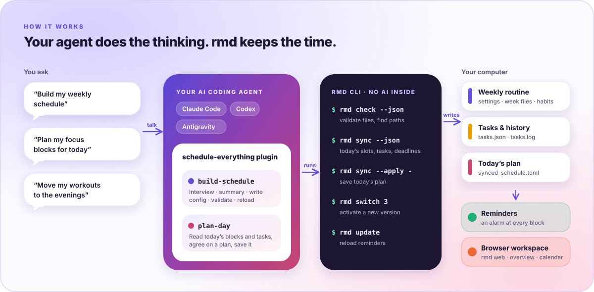
</p>

The plugin's skills do the thinking. The `rmd` CLI does the deterministic
work they need: `rmd check` validates your configuration and reports its
paths, `rmd sync --json` describes today's focus blocks and open tasks, and
`rmd sync --apply` saves today's plan. A background service turns the result
into reminders, and `rmd web` shows everything in the browser.

## Quick start

### 1. Install Schedule Everything

```bash
curl -fsSL https://raw.githubusercontent.com/AutoPhd-org/schedule-everything/main/install.sh | bash
```

Or from a clone:

```bash
git clone https://github.com/AutoPhd-org/schedule-everything.git
cd schedule-everything
./install.sh
```

The installer puts the `rmd` binary in `~/SCHEDULE_MANAGEMENT` (a prebuilt
release download, or built with `cargo` when you run it from a clone),
scaffolds your configuration in `~/.schedule_management/config`, and registers
the reminder service (LaunchAgent on macOS, systemd on Linux). No Python is
needed, and existing configuration is kept. `pip install schedule-management`
also installs the binary, if you prefer to manage it with pip or uv.

### 2. Add the plugin to your AI agent

<table>
  <tr><th>Claude Code</th><th>OpenAI Codex</th><th>Google Antigravity</th></tr>
  <tr>
    <td valign="top"><pre lang="bash">claude plugin marketplace add AutoPhd-org/schedule-everything
claude plugin install schedule-everything@schedule-everything</pre></td>
    <td valign="top"><pre lang="bash">codex plugin marketplace add AutoPhd-org/schedule-everything
codex plugin add schedule-everything@schedule-everything</pre></td>
    <td valign="top"><pre lang="bash">git clone https://github.com/AutoPhd-org/schedule-everything.git
agy plugin install ./schedule-everything/plugins/schedule-everything</pre></td>
  </tr>
</table>

Inside a Claude Code session you can run the same steps as
`/plugin marketplace add` and `/plugin install`. The installer also prints
these commands, and the browser's **Schedule** page has copy buttons for them.

### 3. Ask your agent

| Say | What happens |
| --- | --- |
| **"Build my weekly schedule"** | `build-schedule` asks about your work, constraints, energy, and habits, shows a plain-language summary, and only after you confirm writes `settings.toml`, `odd_weeks.toml`, `even_weeks.toml`, `habits.toml`, and `profile.md`. It validates them with `rmd check` and reloads reminders. |
| **"Plan my focus blocks for today"** | `plan-day` reads `rmd sync --json`, matches your most important tasks and nearest deadlines to today's pomodoro and potato blocks, confirms with you, and saves the plan with `rmd sync --apply`. |
| **"Move my workouts to the evenings"** | Changes become a new `user_config_<n>` version, validated with `rmd check --dir` and activated with `rmd switch <n>`. Earlier versions stay for rollback. |

### 4. Open the workspace

```bash
rmd web
```

The browser workspace runs on `127.0.0.1` only, reads the same files as the
CLI, and reuses an open tab when you launch it again.

## A tour of the workspace

### Two ways to run your day

<p align="center">
  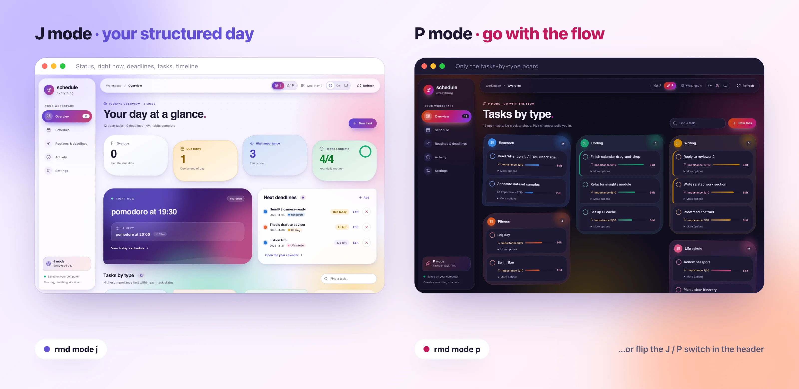
</p>

**J mode** is the structured day: overdue and due-today counts, high-importance
tasks, habit progress, the current and next block, upcoming deadlines, and
today's timeline. **P mode** is for flexible days: alarms for selected events
pause and the overview keeps only your tasks, grouped by type, as a loose
collage. Flip the **J / P** switch in the header, or run `rmd mode j|p`. In
both modes, groups with more important work come first (the **compact**
layout), or switch to **spread** to place them by workload: the heaviest group
in the middle and lighter ones farther out. Groups keep their places while you
work and are arranged anew when you come back to the page. You can add a task
right inside its group, and **Fold** turns each group into a summary of its
importance, progress, and size. Every task has a progress slider, or a
checklist of subtasks that sets its progress. Above the board, timers with
dials count down to today's timed tasks (overdue ones turn red) and to
deadlines in their last 24 hours, under one bar for today's timed work that can
weigh tasks by importance. The **daily overview** sums up your day, and the
theme's colors follow your **workload**: every open task's importance, times
the share of it still left.

### Plan with your agent

<p align="center">
  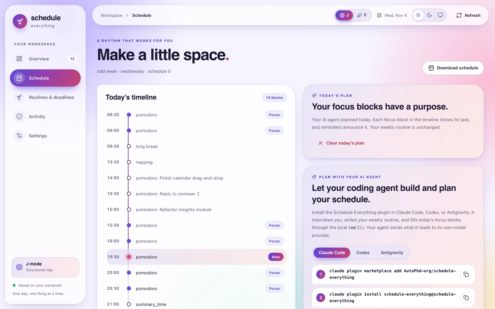
</p>

Today's timeline shows each planned block with its task. The Schedule page
also has the plugin install commands with copy buttons, example prompts, and a
button to clear today's plan.

### Your year at a glance

<p align="center">
  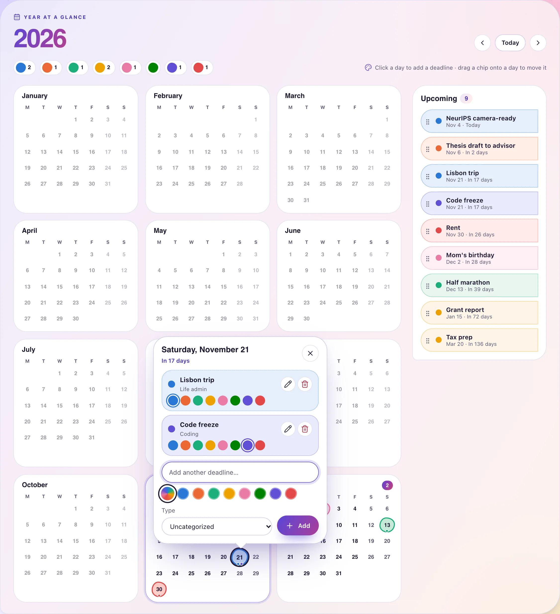
</p>

**Routines & deadlines** puts every deadline on a year calendar. Click a day
to add one, make it repeat weekly, every two weeks, or monthly, pick one of
eight marker colors, recolor or edit it from the day card, and drag a chip onto
another day to reschedule. Repeating events show every occurrence and roll
forward on their own. Turn on **AI conferences** to add this year's submission
deadlines, rebuttal periods, and conference dates for NeurIPS, ICLR, ICML, CVPR,
ACL, ICRA, and other major venues, in your time zone. Today's habits live on the
same page.

### Little wins add up

<p align="center">
  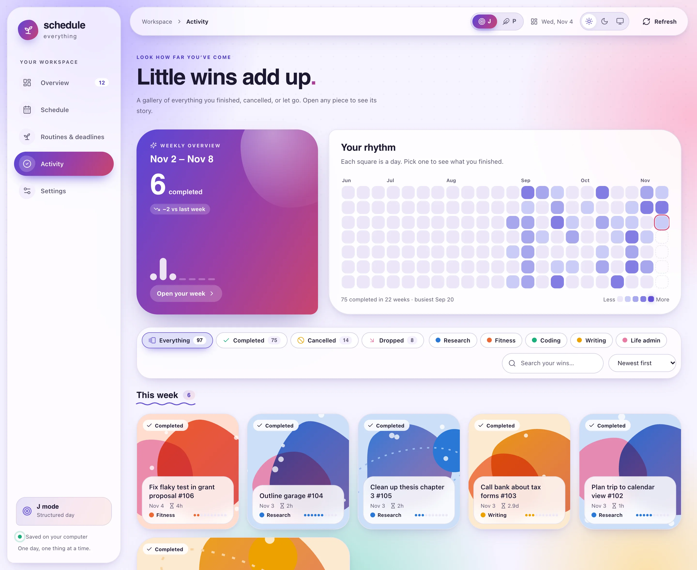
</p>

**Activity** grows everything you finished, cancelled, or let go along a
scrollable timeline tree: each task type has its own lane and color, the trunk
takes the color of the work around it, and a band in the middle highlights what
you are looking at. Prefer cards? Switch to the gallery, where each task has
artwork in its type's color. Filter by outcome or type, search, or click a day
in the rhythm grid. Hover over any task to see when it started, how long it took,
and how that compares with your other tasks.

<table>
  <tr>
    <td width="50%" valign="top">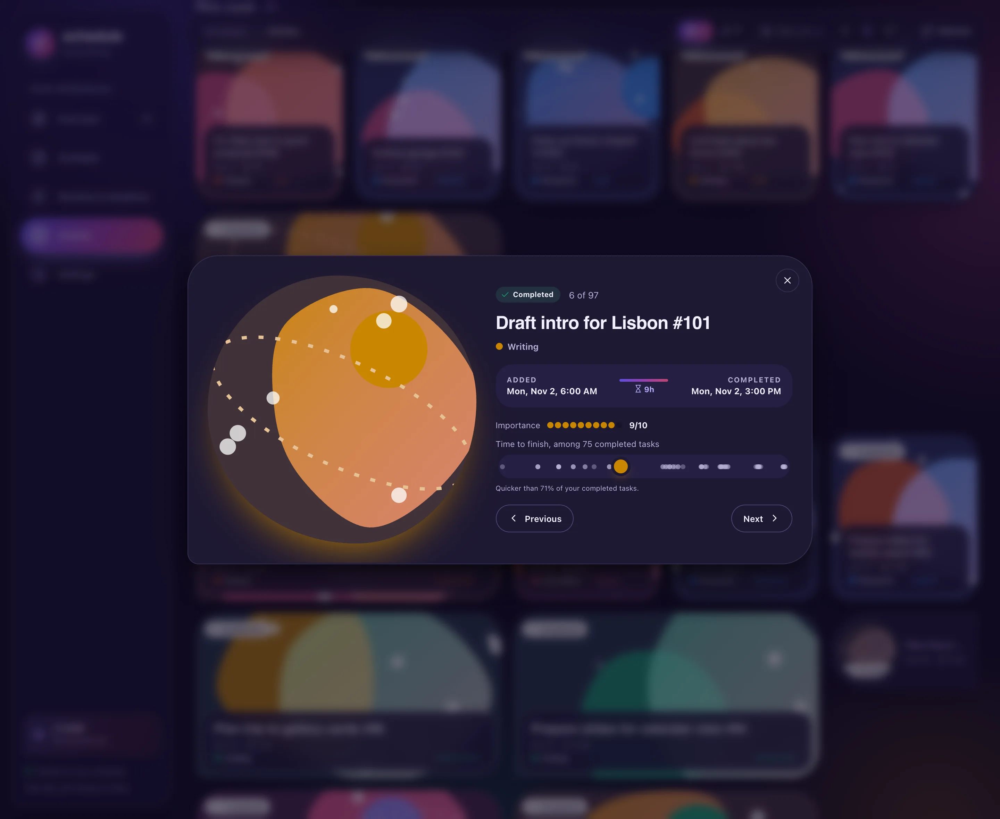</td>
    <td width="50%" valign="top">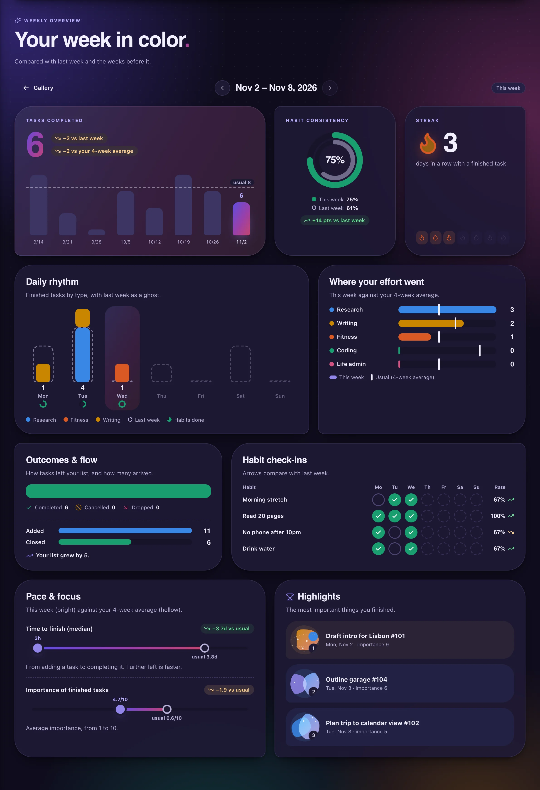</td>
  </tr>
  <tr>
    <td valign="top"><strong>Every task has a story.</strong> Hover over any task for its timeline and pace, or click it for the full view.</td>
    <td valign="top"><strong>Your week in color.</strong> The weekly overview compares this week with last week and your recent average, mostly as charts.</td>
  </tr>
</table>

### On your phone, too

<table>
  <tr>
    <td width="33%">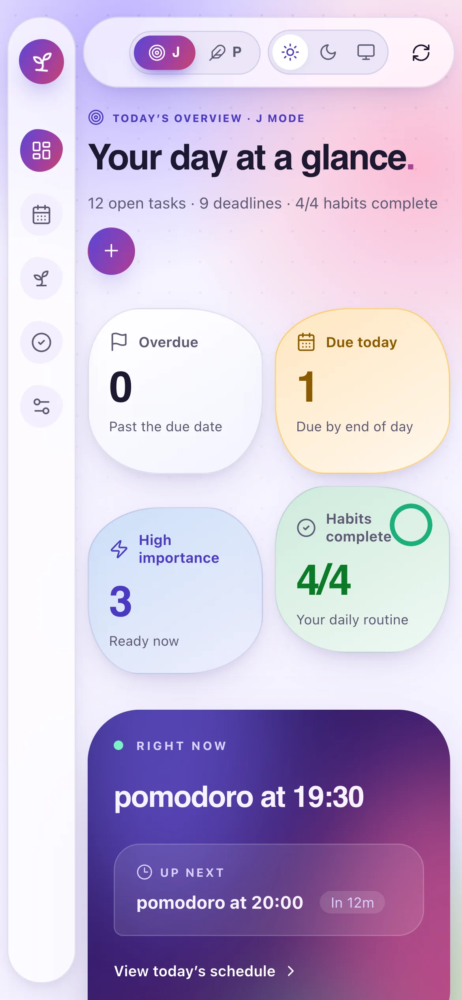</td>
    <td width="33%">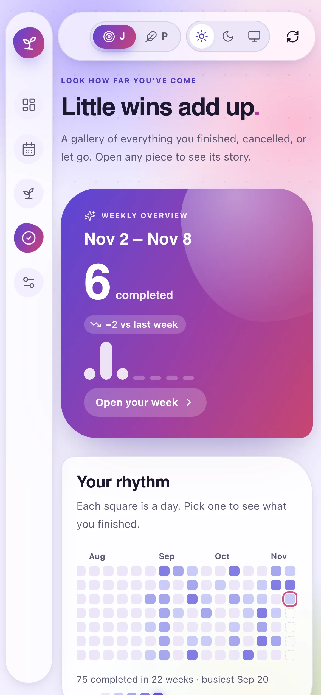</td>
    <td width="33%">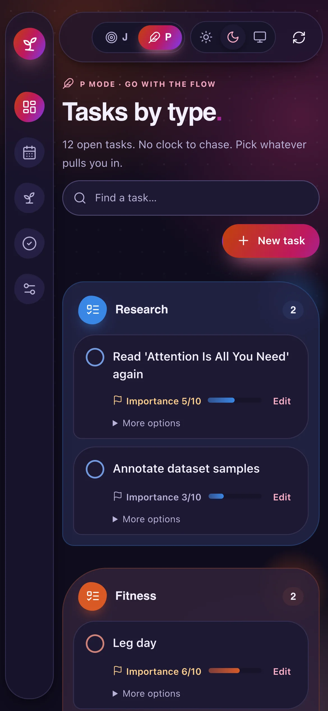</td>
  </tr>
</table>

Light, dark, or system theme, remembered per browser. Motion respects your
system's reduced-motion setting.

## The daily rhythm

<p align="center">
  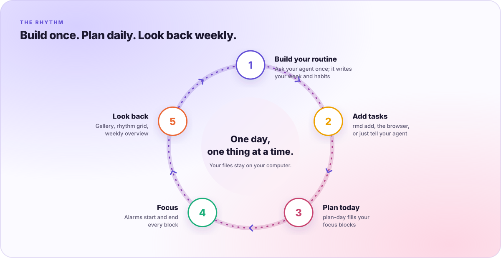
</p>

## How today's schedule is built

<p align="center">
  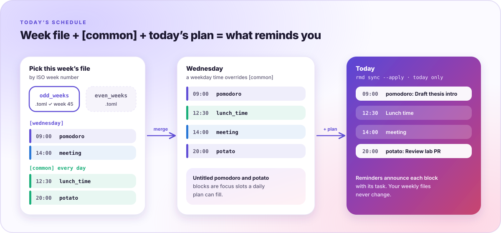
</p>

```toml
# odd_weeks.toml (even_weeks.toml has the same shape)
[wednesday]
"09:00" = "pomodoro"                                  # a [time_blocks] name: alarm at start and end
"14:00" = { block = "meeting", title = "Advisor 1:1" }

[common]                                              # every day; a weekday entry at the same time wins
"12:30" = "lunch_time"                                # a [time_points] name: one reminder
"20:00" = "potato"
```

Untitled `pomodoro` and `potato` blocks are the focus slots a daily plan can
fill. A plan changes only today; your weekly files never change.

## Commands

| Command | What it does |
| --- | --- |
| `rmd web` | Open the browser workspace, reusing an existing tab |
| `rmd status [-v]` | What is happening now and next, with today's planned task titles |
| `rmd add "task" 8 [type] [days]` | Add a task with importance 1–10, an optional type, and an optional postponement |
| `rmd ls` · `rmd rm` · `rmd cancel` · `rmd drop` | List tasks; finish one (counts as completed), or remove one as a mistake or a dropped goal |
| `rmd history [n]` | Recent finished, cancelled, and dropped tasks |
| `rmd ddl` · `rmd ddl add <event> <M.D> [--repeat weekly\|biweekly\|monthly]` · `rmd ddl rm` | Manage deadlines, including repeating ones |
| `rmd track` | Record today's habits |
| `rmd sync [--json \| --apply FILE \| --clear]` | Show today's focus blocks and plan; `--json` and `--apply` are what `plan-day` uses |
| `rmd check [--dir DIR] [--json]` | Validate a config directory and report its paths |
| `rmd mode [j\|p]` | Show or switch between J and P mode |
| `rmd switch <id>` · `rmd update` · `rmd stop` | Activate a `user_config_<n>` version, reload reminders, or stop them |
| `rmd settings` | Edit `settings.toml` in an interactive terminal UI |
| `rmd view` · `rmd report weekly\|monthly` | Export a schedule PDF or a productivity report |

## Configuration

```text
~/.schedule_management/config/
├── user_config_0/            # one complete version of your routine
│   ├── settings.toml         # time blocks, time points, reminder times, task types
│   ├── odd_weeks.toml        # schedule for odd ISO weeks
│   ├── even_weeks.toml       # schedule for even ISO weeks
│   ├── habits.toml           # daily habits
│   ├── ddl.json              # deadlines (with optional marker colors)
│   └── profile.md            # what your agent knows about you
├── user_config_1/            # a later version made by build-schedule
├── synced_schedule.toml      # today's plan
└── tasks/                    # tasks, history, habit records, mode
```

You can edit every file by hand, in the browser's configuration editor, or
with `rmd settings`. Run `rmd check` after manual edits.

## Documentation

- [Introduction](https://autophd-org.github.io/schedule-everything/docs/intro)
- [AI agent plugins](https://autophd-org.github.io/schedule-everything/docs/ai-agents)
- [Quick start](https://autophd-org.github.io/schedule-everything/docs/quick-start)
- [Browser workspace](https://autophd-org.github.io/schedule-everything/docs/browser)
- [Configuration](https://autophd-org.github.io/schedule-everything/docs/configuration/overview)
- [CLI reference](https://autophd-org.github.io/schedule-everything/docs/cli/overview)

## Development

`rmd` is written in Rust (`crates/rmd`); the browser frontend is TypeScript.

```bash
cargo build                    # target/debug/rmd
cargo test                     # unit tests and the golden parity tests
cargo clippy --all-targets

bun install
bun run test            # browser workspace tests (Vitest; plain `bun test` is Bun's own runner)
bun run build           # rebuild the bundled browser assets
```

JavaScript dependencies are managed with [Bun](https://bun.sh) (`bun.lock`);
the tools themselves run on Node.js 20 or newer. The browser frontend lives in
`web/`, and `bun run build` writes the bundle into
`src/schedule_management/web/static/`, which is compiled into the `rmd` binary.
The agent plugin is in [`plugins/schedule-everything`](plugins/schedule-everything).

To release, bump `version` in the root `Cargo.toml` on `main`: the Release
workflow then builds the `rmd` archives that `install.sh` downloads and the
PyPI wheels.

The original Python implementation in `src/schedule_management` is kept as
the reference the Rust port is tested against:
[`tests/golden`](tests/golden) records its output for CLI commands and
browser API requests, and `cargo test` checks that `rmd` matches.

## License

Distributed under the **MIT License**. See [LICENSE](LICENSE).
