<p align="center">
  
</p>

<h1 align="center">Schedule Everything · 晨钟暮鼓</h1>

<p align="center">
  <strong>让你的 AI 智能体规划一周，让持续的提醒帮你坚持下去。</strong><br>
  本地优先的周计划、任务清单与专注时间块提醒工具。一个 <code>rmd</code> 可执行文件同时提供命令行、后台提醒服务和浏览器工作区。
</p>

<p align="center">
  <a href="https://github.com/AutoPhd-org/schedule-everything/actions/workflows/rust.yml"></a>
  <a href="https://github.com/AutoPhd-org/schedule-everything/actions/workflows/browser-tests.yml"></a>
  <a href="https://pypi.org/project/schedule-management"></a>
  <a href="https://opensource.org/licenses/MIT"></a>
</p>

<p align="center">
  <a href="#快速开始">快速开始</a> ·
  <a href="#浏览器工作区">工作区</a> ·
  <a href="#常用命令">常用命令</a> ·
  <a href="https://autophd-org.github.io/schedule-everything/zh/">文档</a> ·
  <a href="README.md">English</a>
</p>

<p align="center">
  
</p>

## 为什么选择 Schedule Everything

<table>
  <tr>
    <td width="33%" valign="top">
      <h3>🧠 智能体负责规划</h3>
      把你的生活讲给 Claude Code、Codex 或 Antigravity 听。<code>build-schedule</code> 技能会先了解你，再写出你的周计划；<code>plan-day</code> 会把今天的专注块安排成具体任务。
    </td>
    <td width="33%" valign="top">
      <h3>⏰ 不会被忽略的提醒</h3>
      后台服务会在每个时间块开始和结束时响铃并弹窗，直到你回应。截止日期、习惯和紧急任务也各有提醒。
    </td>
    <td width="33%" valign="top">
      <h3>🔒 本地纯文本</h3>
      周计划是 TOML，任务和历史是 JSON，全部保存在你的电脑上。不需要账号，也没有云端服务；应用本身不调用任何 AI，你的智能体使用它自己的模型服务。
    </td>
  </tr>
</table>

<details>
<summary><strong>健康的默认原则，而不只是把日程塞满</strong></summary>

当你的偏好还不完整时，`build-schedule` 会优先保护这些基于研究的默认原则：每晚至少 7 小时的睡眠机会并保持规律作息；每周 150–300 分钟中等强度活动，并在两天或以上安排力量训练；在长时间久坐中插入短暂活动休息；把高强度工作放在你最专注的时段；尽量在白天早些时候接触日光。这些只是排程上的启发式原则，不构成医疗建议，你的真实约束始终优先。

- Watson NF 等. Recommended Amount of Sleep for a Healthy Adult. [AASM 共识](https://aasm.org/resources/pdf/pressroom/adult-sleep-duration-consensus.pdf)
- Sletten TL 等. The importance of sleep regularity. [Sleep Health, 2023](https://doi.org/10.1016/j.sleh.2023.07.016)
- 世界卫生组织. 成人身体活动建议. [WHO](https://www.who.int/initiatives/behealthy/physical-activity)
- Albulescu P 等. "Give me a break!" [PLOS ONE, 2022](https://journals.plos.org/plosone/article?id=10.1371/journal.pone.0272460)
- Figueiro MG 等. The impact of daytime light exposures on sleep and mood in office workers. [Sleep Health, 2017](https://doi.org/10.1016/j.sleh.2017.03.005)

</details>

## 工作原理

<p align="center">
  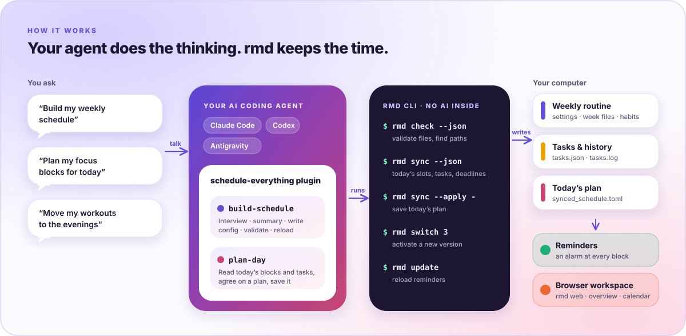
</p>

插件里的技能负责思考，`rmd` 负责它们需要的确定性操作：`rmd check` 校验配置并给出路径，`rmd sync --json` 描述今天的专注块和未完成任务，`rmd sync --apply` 保存今天的计划。提醒服务（`rmd daemon`，登录时自动启动）把这些文件变成提醒，`rmd web` 在浏览器中呈现一切。

<p align="center">
  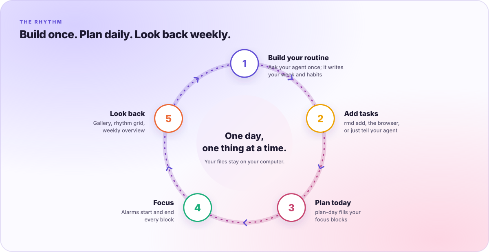
</p>

## 快速开始

### 1. 安装 Schedule Everything

```bash
curl -fsSL https://raw.githubusercontent.com/AutoPhd-org/schedule-everything/main/install.sh | bash
```

或者从克隆的仓库安装：

```bash
git clone https://github.com/AutoPhd-org/schedule-everything.git
cd schedule-everything
./install.sh
```

安装脚本会：

- 把 `rmd` 放到 `~/SCHEDULE_MANAGEMENT`：下载适用于 macOS（Apple 芯片或 Intel）或 Linux（x86_64 或 arm64）的预编译发布版本，从克隆的仓库运行时则用 `cargo` 在本地编译。`--prebuilt` 和 `--from-source` 可指定其中一种，`RMD_VERSION=x.y.z` 可固定版本；
- 在 `~/.schedule_management/config` 中创建配置根目录和第一个 `user_config_0`，并逐项询问缺少的必填设置；
- 注册提醒服务（macOS 上为 LaunchAgent，Linux 上为 systemd 用户服务），升级时会用新的可执行文件重启它。

已有配置不会被覆盖。也可以用 `pip install schedule-management`（或 `uv tool install schedule-management`）安装同一个可执行文件，但这种方式不会创建配置，也不会注册提醒服务。

### 2. 为你的 AI 智能体添加插件

<table>
  <tr><th>Claude Code</th><th>OpenAI Codex</th><th>Google Antigravity</th></tr>
  <tr>
    <td valign="top"><pre lang="bash">claude plugin marketplace add AutoPhd-org/schedule-everything
claude plugin install schedule-everything@schedule-everything</pre></td>
    <td valign="top"><pre lang="bash">codex plugin marketplace add AutoPhd-org/schedule-everything
codex plugin add schedule-everything@schedule-everything</pre></td>
    <td valign="top"><pre lang="bash">git clone https://github.com/AutoPhd-org/schedule-everything.git
agy plugin install ./schedule-everything/plugins/schedule-everything</pre></td>
  </tr>
</table>

在 Claude Code 会话中也可以用 `/plugin marketplace add` 和 `/plugin install`
完成相同步骤。安装脚本也会打印这些命令，工作区的 **Schedule** 页面提供一键复制。

### 3. 告诉你的智能体

| 你说 | 会发生什么 |
| --- | --- |
| **“帮我制定每周日程”** | `build-schedule` 会询问你的工作、约束、精力和习惯，先给出文字摘要，经你确认后才写入 `settings.toml`、`odd_weeks.toml`、`even_weeks.toml`、`habits.toml` 和 `profile.md`，再用 `rmd check` 校验并重载提醒。 |
| **“帮我规划今天的专注块”** | `plan-day` 读取 `rmd sync --json`，把最重要的任务和最近的截止日期安排进今天的 pomodoro 和 potato 时间块，与你确认后用 `rmd sync --apply` 保存。 |
| **“把运动挪到晚上”** | 修改会保存为新的 `user_config_<n>` 版本，用 `rmd check --dir` 校验后通过 `rmd switch <n>` 启用，旧版本保留可随时回滚。 |

### 4. 打开工作区

```bash
rmd web
```

工作区只监听 `127.0.0.1`，并且只接受带有它所打开标签页会话令牌的 API 请求。它与命令行读写同一套文件，再次运行 `rmd web` 会复用已打开的标签页。

## 浏览器工作区

共五个页面：**Overview**、**Schedule**、**Routines & deadlines**、**Activity** 和 **Settings**。

### Overview：J 模式与 P 模式

<p align="center">
  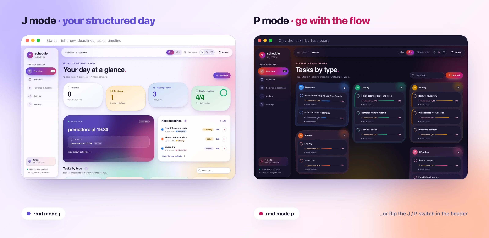
</p>

**J 模式**是有结构的一天：逾期、今日到期、高重要度任务和习惯的数量，当前和下一个时间块，即将到来的截止日期，以及今日时间线。**P 模式**适合更灵活的日子：部分事件的提醒会暂停，页面只保留你的任务。点击页眉的 **J / P** 开关，或运行 `rmd mode j|p` 切换。

- **任务板。** 每种任务类型一个分组。**紧凑**布局把重要工作更多的分组排在前面；**分散**布局按工作量摆放分组，最重的在中间。你在页面上工作时分组保持原位。可以直接在分组里添加任务、设置完成时间，用进度条或子任务清单跟踪进度。点击 **Fold** 可把每个分组折叠成重要度、进度和数量的概览。任务类型也可以直接在任务板上添加、重命名和删除。
- **计时器。** 任务板上方带表盘的计时器会为今晚之前到期的限时任务倒计时（逾期后改为正计时），也会为最后 24 小时内的截止日期倒计时。一条进度条汇总今天限时任务的整体进度，并可按重要度加权。
- **每日概览。** 今天完成了什么、在什么时候完成，与昨天和你平常的一天对比，还有连续天数、习惯和剩余的未完成工作。
- **工作量。** 每个未完成任务按“重要度 / 10 × 剩余比例”计入（重要度为 8 的任务未开始时计 0.8，完成一半时计 0.4）。主题配色随总量变化，从 *All clear* 依次经过 *Light*、*Steady*、*Busy* 到 *Heavy*。可以在 Settings 中调整各级别的起点，或关闭随工作量变化的主题。

### Schedule：和智能体一起规划

<p align="center">
  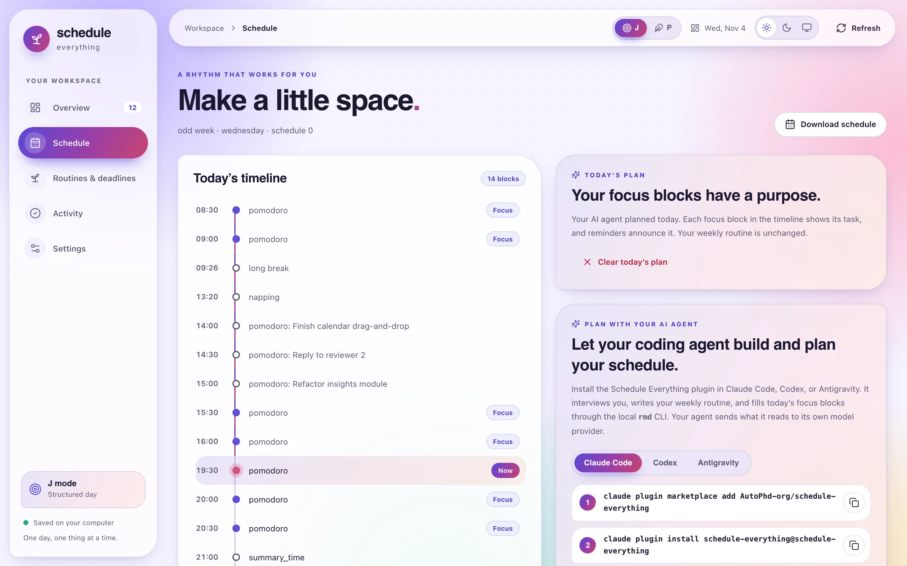
</p>

今日时间线会显示每个时间块及其计划的任务。页面还提供插件安装命令的复制按钮、示例提问，以及清除今日计划的按钮。

### Routines & deadlines：一年尽收眼底

<p align="center">
  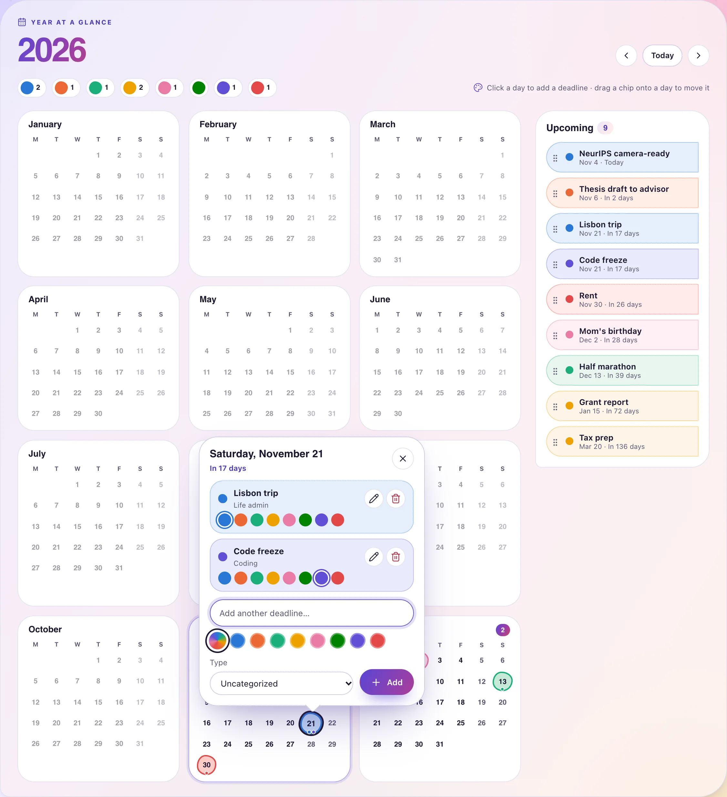
</p>

所有截止日期都在一张年历上。点击某一天即可添加，可设为每周、每两周或每月重复，并选择八种标记颜色之一。在日期卡片中可以改色或编辑，把它的卡片拖到另一天即可改期。重复的截止日期会显示每一次的日期，并自动顺延到下一次。打开 **AI conferences** 后，年历会按你的时区显示 NeurIPS、ICLR、ICML、CVPR、ACL、ICRA 等主要会议的投稿截止日期、rebuttal（作者回复）期和会期。今日习惯也在这个页面。

### Activity：积少成多

<p align="center">
  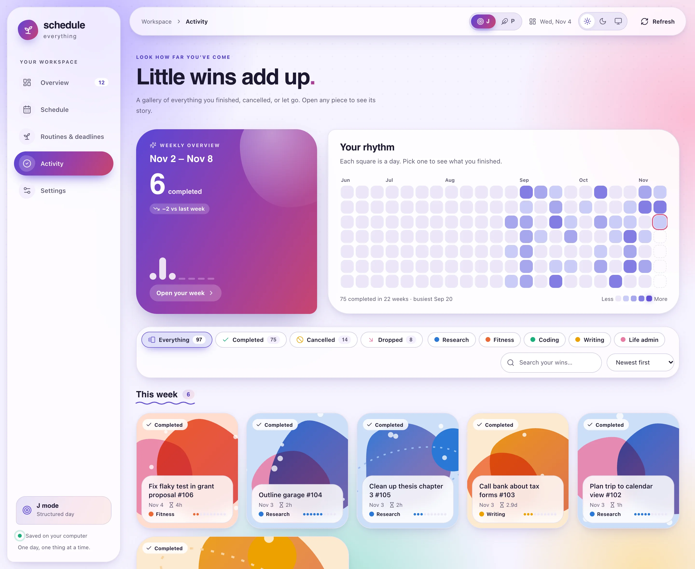
</p>

你完成、取消或放弃的所有任务都排在一棵可滚动的时间树上，每种任务类型有自己的车道和颜色。也可以切换到画廊，每个任务都带有与其类型同色的图案。可以按结果或类型筛选、搜索，或点击节奏格中的某一天。把鼠标悬停在任意任务上，就能看到它何时开始、用了多久，以及与其他任务相比如何。

<table>
  <tr>
    <td width="50%" valign="top">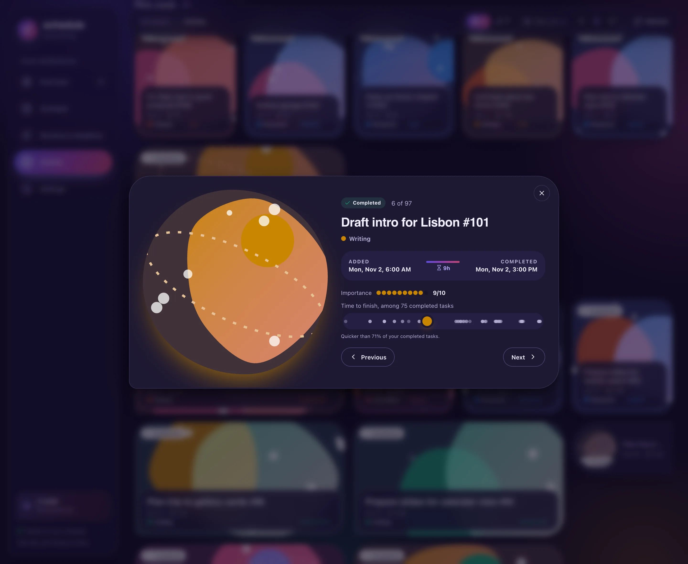</td>
    <td width="50%" valign="top">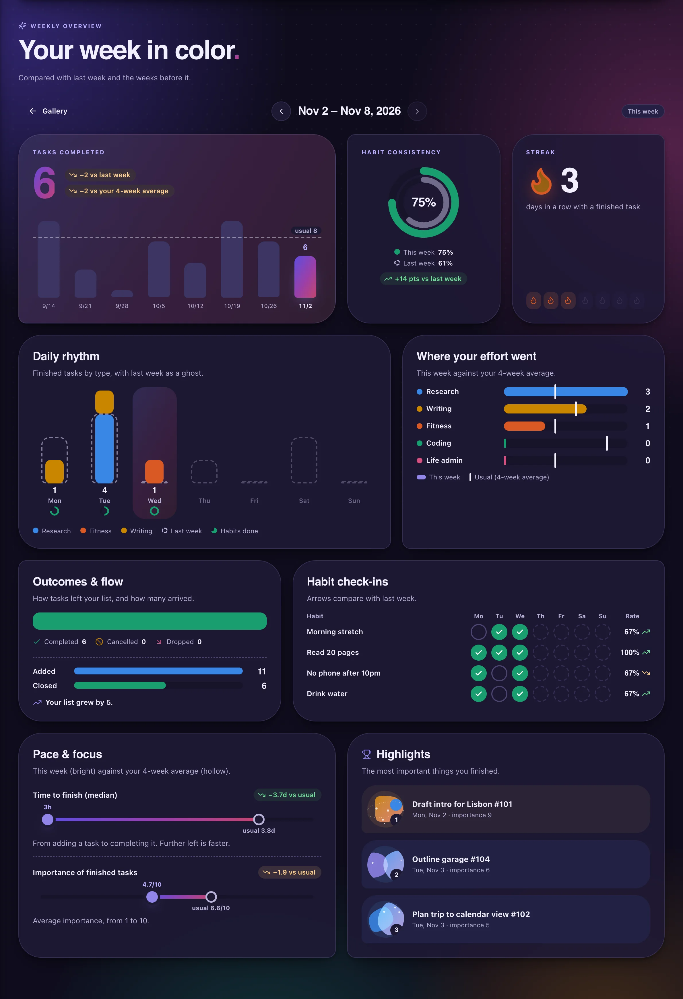</td>
  </tr>
  <tr>
    <td valign="top"><strong>每个任务都有故事。</strong>点击任务查看它的时间线和节奏。</td>
    <td valign="top"><strong>你的一周，色彩分明。</strong>每周概览把本周与上周以及最近几周的平均水平对比。</td>
  </tr>
</table>

### Settings

任务板、工作量和进度的偏好；提醒偏好；任务和截止日期类型；以及配置文件编辑器。每次保存都会按与 `rmd check` 相同的规则校验，并且不会覆盖更新的修改。

### 手机上也能用

<table>
  <tr>
    <td width="33%">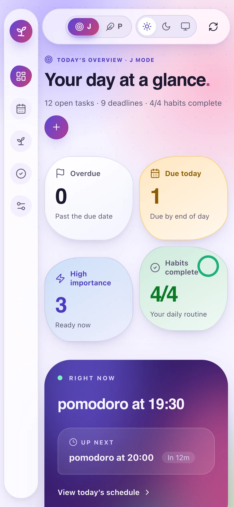</td>
    <td width="33%"></td>
    <td width="33%">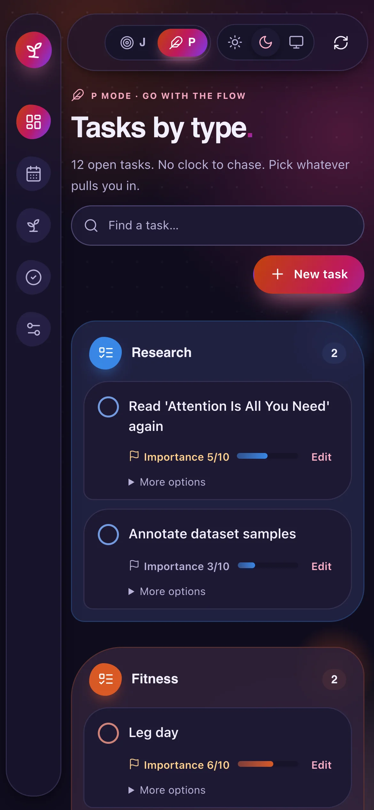</td>
  </tr>
</table>

支持浅色、深色或跟随系统主题，并按浏览器记住你的选择；动效会遵循系统的“减少动态效果”设置。

## 今天的日程如何生成

<p align="center">
  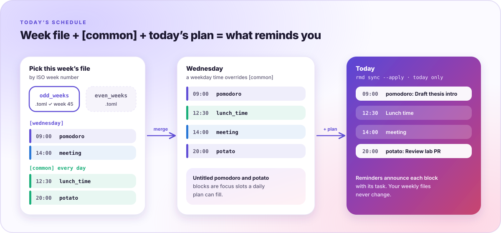
</p>

```toml
# odd_weeks.toml（even_weeks.toml 结构相同）
[wednesday]
"09:00" = "pomodoro"                                  # [time_blocks] 名称：开始和结束时都会提醒
"14:00" = { block = "meeting", title = "Advisor 1:1" }

[common]                                              # 每天都生效；同一时间的工作日条目优先
"12:30" = "lunch_time"                                # [time_points] 名称：提醒一次
"20:00" = "potato"
```

未命名的 `pomodoro` 和 `potato` 时间块就是每日计划可以填充的专注块。计划只影响今天，你的每周文件不会改变。

## 常用命令

| 命令 | 作用 |
| --- | --- |
| `rmd web [--port N] [--no-open]` | 打开浏览器工作区，复用正在运行的服务和标签页 |
| `rmd status [-v]` | 显示当前和下一项安排，以及今天计划的任务标题 |
| `rmd add "任务" 8 [类型] [天数]` | 添加重要度 1–10 的任务，可选类型 ID，并可把紧急提醒延后若干天 |
| `rmd ls [-t 类型]` | 按重要度列出任务，可只看某一类型 |
| `rmd rm` · `rmd cancel` · `rmd drop` | 按描述或 ID 移除任务：已完成（计为完成）、误加或放弃 |
| `rmd history [n]` | 最近完成、取消和放弃的任务 |
| `rmd ddl` · `rmd ddl add <事件> <月.日> [--repeat weekly\|biweekly\|monthly]` · `rmd ddl rm <事件>…` | 列出、添加和删除截止日期，包括重复的截止日期 |
| `rmd track [id…]` | 记录今天的习惯（不带 ID 时逐项询问） |
| `rmd sync [--json \| --apply FILE \| --clear]` | 显示、保存或清除今日计划；`plan-day` 使用 `--json` 和 `--apply` |
| `rmd check [--dir DIR] [--json]` | 校验配置目录并给出路径 |
| `rmd mode [j\|p]` | 查看或切换 J / P 模式 |
| `rmd switch <n>` | 启用 `user_config_<n>` 并重载提醒 |
| `rmd update` · `rmd stop` | 重载提醒（配置根目录是 git 仓库时先执行 `git pull`），或停止提醒 |
| `rmd settings` · `rmd edit [文件]` | 在终端界面中编辑 `settings.toml`，或用编辑器打开某个配置文件 |
| `rmd view` · `rmd report weekly\|monthly [-d 日期]` | 导出日程 PDF 或效率报告 |
| `rmd completion [bash\|zsh\|fish\|tcsh]` | 输出 shell 补全脚本 |

## 配置结构

```text
~/.schedule_management/config/
├── user_config_0/            # 一个完整的周计划版本
│   ├── settings.toml         # 时间块、时间点、提醒时间、任务类型
│   ├── odd_weeks.toml        # 单周（ISO 周数为奇数）日程
│   ├── even_weeks.toml       # 双周日程
│   ├── habits.toml           # 每日习惯
│   ├── ddl.json              # 截止日期（可设重复和标记颜色）
│   └── profile.md            # 智能体对你的了解
├── user_config_1/            # build-schedule 生成的新版本
├── synced_schedule.toml      # 今日计划
└── tasks/                    # 任务、历史、习惯记录、模式
```

每个文件都可以手动编辑、在工作区的配置编辑器中修改，或通过 `rmd settings` 编辑，手动修改后请运行 `rmd check`。设置 `REMINDER_CONFIG_DIR` 可以让 `rmd` 使用其他配置根目录。

## 文档

- [简介](https://autophd-org.github.io/schedule-everything/zh/docs/intro)
- [AI 智能体插件](https://autophd-org.github.io/schedule-everything/docs/ai-agents)
- [快速开始](https://autophd-org.github.io/schedule-everything/docs/quick-start)
- [安装](https://autophd-org.github.io/schedule-everything/docs/installation)
- [浏览器工作区](https://autophd-org.github.io/schedule-everything/docs/browser)
- [配置](https://autophd-org.github.io/schedule-everything/docs/configuration/overview)
- [命令行参考](https://autophd-org.github.io/schedule-everything/docs/cli/overview)

## 开发

| 路径 | 内容 |
| --- | --- |
| [`crates/rmd`](crates/rmd) | Rust 编写的 `rmd`：命令行、提醒服务、本地 Web 服务器、PDF 报告 |
| [`web`](web) | TypeScript 编写的浏览器工作区，由 Vite 打包到 `crates/rmd/web-static` |
| [`plugins/schedule-everything`](plugins/schedule-everything) | 智能体插件及其 `build-schedule` 和 `plan-day` 技能 |
| [`config`](config) | 安装脚本复制到新配置根目录的模板 |
| [`documentation`](documentation) | Docusaurus 文档站点 |
| [`tests/golden`](tests/golden) | `cargo test` 回放的命令行与浏览器 API 记录用例 |

```bash
cargo build                     # 生成 target/debug/rmd
cargo test                      # 单元测试与黄金用例
cargo fmt --all --check
cargo clippy --all-targets -- -D warnings

bun install
bun run test                    # 浏览器测试（Vitest；直接运行 `bun test` 会调用 Bun 自带的测试器）
bun run build                   # 重新构建 crates/rmd/web-static
```

JavaScript 依赖由 [Bun](https://bun.sh) 管理（`bun.lock`），相关工具运行在 Node.js 20 或更新版本上。构建好的前端会编译进 `rmd` 可执行文件，所以修改前端时请一并提交 `crates/rmd/web-static`，并重新构建 `rmd` 才能提供新资源。需要实时刷新地开发前端时，运行 `rmd web --port 8765 --no-open` 和 `bun run dev`。

黄金用例记录自 `rmd` 所取代的早先 Python 实现，固定了它的命令行输出、浏览器 API 响应和数据文件。详见 [`tests/golden/README.md`](tests/golden/README.md) 和 [`crates/rmd/PORTING.md`](crates/rmd/PORTING.md)。

发布新版本时，在 `main` 上修改根目录 `Cargo.toml` 中的 `version`。Release 工作流随后会发布 `install.sh` 下载的 `rmd` 压缩包和 PyPI wheel。

## 许可证

采用 **MIT License** 发布，详见 [LICENSE](LICENSE)。
